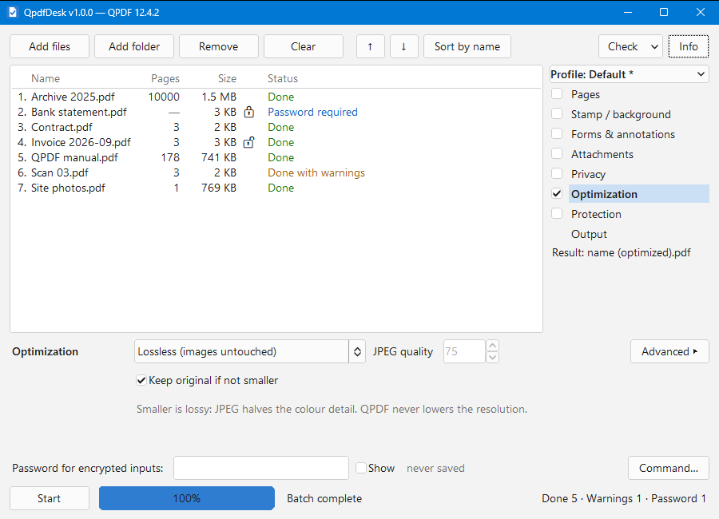

# QpdfDesk

*[Wersja polska](README.pl.md)*

A small Windows desktop app that lets you use [QPDF](https://qpdf.readthedocs.io/) without typing commands: **drop PDF files, tick the steps, press Start.** Merge, split, pick and rotate pages, protect or unprotect, optimize, repair, strip metadata, flatten forms, add or pull out attachments, lay one PDF over another — each result checked by QPDF before it is given its name, and the original never touched.



## Download

Get `QpdfDesk-1.0.0-win64.zip` from the [Releases page](../../releases/latest), check its SHA-256 against the one published there, unpack it anywhere and follow `READ_ME_FIRST.txt`: QpdfDesk does not include QPDF, which you download once from its [official releases](https://github.com/qpdf/qpdf/releases) and unpack next to `QpdfDesk.exe`. Nothing is installed.

## Features

- **One chain, one pass** — the chosen steps run in a single QPDF call per result: no intermediate files.
- **Pages** — keep, delete or reverse pages (`1-5,8`, `z` = the last; the field's tooltip has the rest) and rotate them; each file on its own, or every file merged into one or mixed page by page. The pages chosen apply to every file; *Arrange pages…* gives one file its own — removed and reordered, by number or label. A merge keeps no bookmarks (the outline): QPDF builds it from an empty document.
- **Stamp / background** — the pages of another PDF on top of your pages (a stamp, a watermark) or under them (a letterhead): its page 1 on each page, its pages in order, or its pages in turn (one background for odd pages, another for even ones) — on every page, or on the pages you type.
- **Forms & annotations** — flatten them into the page, or remove the form and keep its look.
- **Attachments** — embed files, remove the existing ones, or pull them out safely: hostile names are defused and every extracted file gets the "downloaded from the internet" mark.
- **Privacy** — remove document info and XMP metadata, a fixed document ID; in Advanced, the structure tree and page labels.
- **Optimization** — lossless (images untouched), or smaller: images re-encoded as JPEG, while the JPEGs a file has stay as they are — unless a quality is set, which compresses them again; "keep the original if not smaller". JPEG keeps the colour at half the resolution (4:2:0), and QPDF has no way to change that: for exact colours, use Lossless.
- **Protection** — lock with a password (AES-256, an open and an owner password, the usual permissions), or unlock: no password, no restrictions.
- **Output** — always on: where results go and what they are called, split into files of N pages (the parts keep no bookmarks), fast web view.
- **A step switched off** has its options grey: they do nothing until it is on.
- **Check and Info** — `qpdf --check` on any file, with a report; what a file holds (pages, encryption, labels, attachments, metadata).
- **Profiles** — save a set of steps and options under a name: the steps chosen and their options only, so a profile holds no file path of a step it leaves off. Every start begins with no step chosen: with none, the Start button says Repair.
- **Command…** — the exact `qpdf` command for the selected file, passwords masked, ready to paste into cmd.exe: it makes the very same file.
- **Safe by design** — the original is never overwritten; results go to a temporary file, are verified by `qpdf --check` (pages counted) and only then renamed, never over an existing file. Passwords stay in memory: never on a command line, in a file, in the report or on the clipboard.
- **Light** — one ~1.4 MB executable, no installer, about 4 MB of memory and no processor use while idle; QPDF runs at low priority inside a Windows job that caps its memory and is closed with the app.

## Requirements

- Windows 10 or 11, 64-bit.
- QPDF **12.4 or newer** (the official `msvc64` ZIP). QpdfDesk looks for it next to itself first (`qpdf\bin`, `qpdf-*\bin`, `bin`), then in Program Files, then on `PATH`. Without it the window still opens and says what is missing.

## Settings

`settings.txt` next to the executable is written when the app closes: window size and last folder. Three options exist only there:

```ini
threads=
qpdf_memory_mb=
language=
```

Empty means automatic. `threads` — how many files are processed (and looked at for their pages) at once, 1–16; automatic: half the processor's logical cores, at most 4. QPDF uses one core per file, so two at once roughly halve a long batch (measured: 32 files 26.6 s → 12.7 s), and it always runs below normal priority. `qpdf_memory_mb` — the memory all QPDF processes may use together (automatic: half the RAM, at most 8 GB). `language` — the language of the window (`en`); automatic: the language of Windows when QpdfDesk has it, else English. Out-of-range values mean automatic.

Files and folders are dropped on the list, which is outlined while a drag is over it; where nothing takes a drop, the cursor says no. A PDF dropped on the file field of Stamp / background becomes the stamp, files dropped on the Attachments options are attached, and a folder dropped on the folder field of Output receives the results — one file or one folder where only one fits.

Adding a folder can be stopped with Cancel (where Start was) or Esc — useful when a whole drive was dropped by mistake. About is in the title bar's menu (right click on it) and on F1.

The list holds up to 10,000 files at a time; a larger folder adds the first 10,000 in name order and says how many were left out.

## Building from source

```bash
cargo run              # development build
cargo build --release  # optimized for size
cargo test             # unit tests; the integration tests use QPDF in bin\
```

The `fltk-bundled` feature downloads a prebuilt FLTK, so CMake is not needed. The C runtime is linked statically (`.cargo/config.toml`), so the EXE needs no Visual C++ Redistributable. The icon and the version block are generated by `build.rs`. Integration tests expect the official QPDF ZIPs unpacked in `bin\qpdf-12.4.2-msvc64` and `bin\qpdf-12.4.2-mingw64`; without them they are skipped.

## Translating

Every text the window shows is in `lang/en.txt` (`key = text`), compiled into the executable. A language is `lang/<code>.txt` with the same keys — a key it leaves out shows in English — plus one line in `LANGUAGES` in `src/text.rs`. Plurals have the forms `one`, `few` and `many`. A catalog that would show wrong does not build: an unknown or repeated key, other values filled in than in English, a character a button, menu or drop-down cannot show — the error names the file and line. A development build run with `QD_LANG=<code>` shows the language, and with `QD_FIT=<file>` lists every label that does not fit its place.

What changed in each release: [CHANGELOG.md](CHANGELOG.md).

## Licensing

QpdfDesk is released under the MIT License — see [LICENSE](LICENSE).

QPDF is a separate project by Jay Berkenbilt and contributors under the Apache License 2.0. QpdfDesk only **starts `qpdf.exe` as an external process** and does not include or link it.
